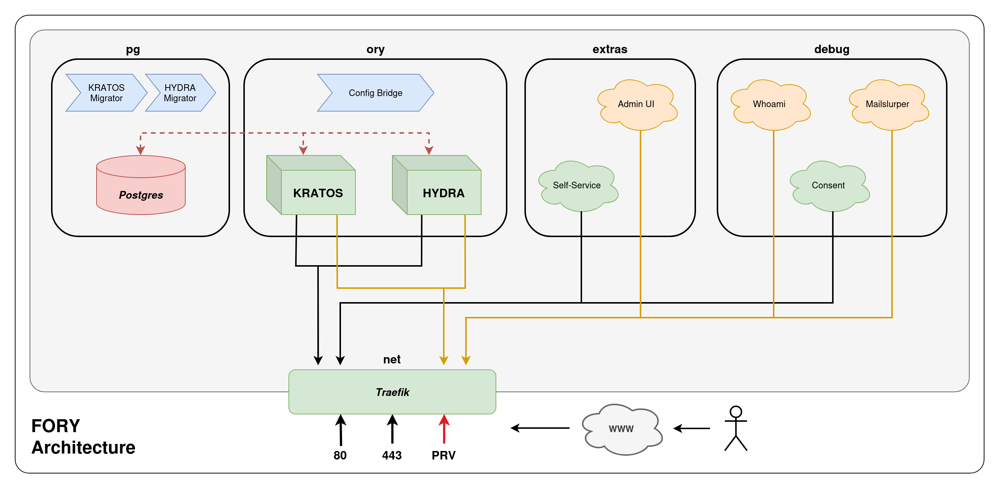

# Fifteen Minute Ory (FiMOr)

A highly streamlined approach to deploying a production grade [_Ory_](https://www.ory.com/) identity stack in _Docker Compose_ - [_Kratos_](https://www.ory.com/kratos) for sessions and [_Hydra_](https://www.ory.com/hydra) for OAuth, backed by _Postgres_ and with a _Traefik_ gateway in front of it all, plus all the usual first-deployment pitfalls already stepped around.

## Overview

_FiMOr_ focuses on the fastest way to get a production-ready _Ory_ deployment onto a raw host in less than fifteen minutes - so you aren't left stitching together _Kratos_, _Hydra_, a database, migrations, a reverse proxy, and a pile of cross-referencing config files for days before you can even try a login. FiMOr is a modular building block, not a finished product: every piece is its own _Compose_ file, they share one network and one environment file, and you can swap or drop any of them. What comes in the Box: _Kratos_ and _Hydra_ pre-wired together for session and oauth support, a _Postgres_ database with _Ory_ stack auto-migrators, _Traefik_ with fully automated SSL certificates, a self-service UI, an admin UI - and with a set of debug services that prove the whole flow works before you trust it.

What you get:
- **Five Independent Modules:** `pg`, `ory`, `net`, `extras`, and `debug` - each one a single _Compose_ file you can start, stop, or replace on its own.
- **One Environment File, Zero Hand-Edited Config:** _Kratos_ and _Hydra_ configuration is rendered from templates and your environment on every start, so there is exactly one place to change a domain, a path, or a secret.
- **Generated Secrets:** `./fimor init` creates `.env.local` with fresh random values for every secret, and `./fimor up` refuses to run while any placeholder is left unset.
- **Separate Public/Private Lanes:** user-facing flows live on the public HTTPS entrypoint; the admin APIs, admin UI, dashboards and debug tools live on a separate private HTTPS port.
- **Staging First:** certificates default to the **Let's Encrypt** staging resolver, so you can prove DNS and routing before touching the production issuer and its rate limits.
- **Debug Services That Prove It Works:** an OAuth2 client/server mock, mailslurper for debugging verification and recovery emails, and a `whoami` canary - all in their own module, all easy to swap or remove.
- **Host Bring-up Scripts** for _Docker_, the `ufw` firewall, and `swap` space on _Debian_ and _Ubuntu_ hosts.

## Ory Services

- **Kratos**: [State-lite session management](https://www.ory.com/kratos) - registration, login, verification, recovery, and settings flows, with `password` and `code` methods enabled
- **Hydra**: [State-lite OAuth2.0 server](https://www.ory.com/hydra) - issues JWT access tokens and delegates login and consent to the _Kratos_ self-service UI

## Pre-Requisites

- _Docker Engine_ and _Compose_ plugin (scripts provided for **Debian** & **Ubuntu**)
- _curl_, _openssl_ and _jq_, if not installed by default on your host (`openssl` generates secrets, `jq` is used by client scripts)
- A domain you control, with two DNS **A** records pointing at the host's public IPv4 address:
  - Base domain: _domain.example.com_
  - Wildcard subdomain: _*.domain.example.com_
- Public ports **80** and **443** reachable from the internet - the **ACME** TLS-ALPN challenge needs 443 for every certificate, **_including those for private hostnames_**
- The private HTTPS port (`PRIVATE_HTTPS_PORT`, default **8443**) reachable by you - and, ideally, only by you. See [Firewall](docs/networking.md#firewall)

## Quick Start

All commands run from the repository root.

1. **Initialise the environment:**
   ```sh
   ./fimor init
   ```
   This creates `.env.local` with freshly generated secrets. Edit it and set `SERVICE_DOMAIN` and `ACME_CERTIFICATE_EMAIL` - the only two values you have to supply.

2. **Provision the host** (optional, fresh machine):
   ```sh
   ./scripts/install-docker-ubuntu.sh     # or install-docker-debian.sh
   ./scripts/configure-ufw.sh             # review the Firewall section of docs/networking.md first, then run
   ./scripts/configure-swap.sh            # SWAP_PERCENT is 100 (% of system RAM) by default
   ```

3. **Start the stack** in **BRINGUP MODE** - staging certificates, once DNS has propagated:
   ```sh
   ./fimor up
   ```
   It creates the `ory_backend` network, starts _Traefik_, renders the configs, starts _Postgres_ and runs the _Kratos_ and _Hydra_ migrations, then starts _Kratos_, _Hydra_, and the extras. When it finishes it prints the endpoints for your domain.

4. **Validate the flows** with the debug services - see [Validating Your Setup](docs/validation.md#validating-your-setup). Don't continue until it passes.

5. **Switch to PRODUCTION MODE.** Uncomment the `ACME_DEFAULT_RESOLVER="prd"` line that `./fimor init` left in `.env.local`, then restart the whole stack so every route picks up the new resolver:
   ```sh
   ./fimor down
   ./fimor clean
   ./fimor up
   ```
   See [Certificates](docs/networking.md#certificates) for why to get everything right on staging _first_.

6. **Drop the debug services** and point _Kratos_ at a real mail provider - see [Going to Production](docs/operations.md#going-to-production).

## Architecture



**FiMOr's edge is built on [_TIBIA_](https://github.com/315Concepts/TIBIA-router).** The `net` module is _TIBIA_'s _Traefik_ conventions - entrypoints, staging and production **ACME** resolvers, label-driven routing, and the firewall model - applied to an _Ory_ stack.

Everything joins one external _Docker_ network, `ory_backend`, created by `./fimor up` and removed by `./fimor down`. _Traefik_ is the only container with published ports; it discovers every other service through `traefik.*` labels and routes by hostname or path.

The full picture is in [docs/architecture.md](docs/architecture.md):

- [Modules](docs/architecture.md#modules) - `net`, `pg`, `ory`, `extras` and `debug`, and what each _Compose_ file runs
- [Config Bridge](docs/architecture.md#config-bridge) - how templates and your environment become _Kratos_, _Hydra_ and SQL configuration
- [Auto-Migrators](docs/architecture.md#auto-migrators) - how the database schemas stay in step with `ORY_VERSION`
- [Startup Order](docs/architecture.md#startup-order) - why `./fimor up` starts things the way it does
- [Built on TIBIA](docs/architecture.md#built-on-tibia) - what the `net` module shares with _TIBIA_, and what _FiMOr_ changes

## Operations

Everyday running of the stack lives in [docs/operations.md](docs/operations.md):

- [Configuration](docs/operations.md#configuration) - every environment variable, defaults, and precedence between `.env` and `.env.local`
- [Operating the Stack](docs/operations.md#operating-the-stack) - stopping, working one module at a time, backups, resets, and _Ory_ upgrades
- [Going to Production](docs/operations.md#going-to-production) - retiring the debug services, real SMTP, and hardening the defaults
- [Scripts](docs/operations.md#scripts) - the `./fimor` commands, the host bring-up scripts, and the _Hydra_ client utilities

## Networking

Traffic enters through _Traefik_ on two lanes, public and private, and every route gets a **Let's Encrypt** certificate. The full detail lives in [docs/networking.md](docs/networking.md):

- [Routing](docs/networking.md#routing) - every public and private URL, path-prefix stripping, and how to change a route
- [Entrypoints](docs/networking.md#entrypoints) - the public HTTP/HTTPS ports, the private `PRIVATE_HTTPS_PORT`, and the debug SMTP port
- [Firewall](docs/networking.md#firewall) - which ports to open, and why `ufw` alone isn't enough with _Docker_
- [Certificates](docs/networking.md#certificates) - the `stg` / `prd` resolvers, the certificate cache, and switching to production

## Validation

The `debug` module proves the whole chain - DNS, certificates, routing, _Kratos_ login, _Hydra_ consent, and email delivery - before you attach a real application. The steps and the fixes live in [docs/validation.md](docs/validation.md):

- [Validating Your Setup](docs/validation.md#validating-your-setup) - the checks to run, in order, and what each one proves
- [Troubleshooting](docs/validation.md#troubleshooting) - symptoms and their likely causes, plus where to find logs

## Repository Layout

```text
.
├── fimor                             # helper: init, up, down for the whole stack or one module
├── .env                              # defaults; override in .env.local (git-ignored)
├── .env.base                         # template ./fimor init copies to .env.local
├── docker-compose-net.yaml           # Traefik edge
├── docker-compose-pg.yaml            # Postgres + Kratos/Hydra SQL migrators
├── docker-compose-ory.yaml           # config bridge, Kratos, Hydra
├── docker-compose-extras.yaml        # self-service UI, admin UI
├── docker-compose-debug.yaml         # whoami, consent mock, mailslurper
│
├── ory/
│   ├── envsubst/                     # the config bridge image and its render script
│   ├── kratos/                       # Kratos config files and templates
│   └── hydra/                        # Hydra config files and templates
│       └── utils/                    # Hydra client creation and update scripts
│
├── pg/
│   └── init/                         # *.sqlt templates, rendered to *.sql on start
├── debug/mailslurper/                # config template and entrypoint for mailslurper
├── net/acme/                         # ACME certificate stores (created on first start)
├── scripts/                          # raw host bring-up (Docker, ufw, swap)
├── docs/                             # architecture, networking, validation and operations guides, and the diagram
└── README.md                         # you are here (natch)
```

## Security Notes

FiMOr keeps _Ory_'s and _Traefik_'s defaults except where noted. Here is what is and isn't protected.

- **Secrets.** `./fimor init` generates every secret with `openssl` and writes `.env.local` with mode 600. Treat `KRATOS_CIPHER_SECRET` and `HYDRA_SYSTEM_SECRET` as long-lived: changing them on a running stack needs _Ory_'s secret-rotation procedure, not just a new value. **`.env.local` never belongs in git.**
- **`POSTGRES_PASSWORD`.** The cluster is reachable only on the internal `ory_backend` network, but the default is public knowledge - set your own.
- **Admin surfaces.** The _Kratos_ and _Hydra_ admin APIs, the admin UI, and the _Traefik_ dashboard are served on the private entrypoint with no authentication. By default they are only as private as your firewall makes them.
- **Debug services.** `whoami` echoes request headers, mailslurper exposes every email the stack sends - including recovery and verification codes - and the consent mock takes a client secret on its command line. **_Run them for bring-up only._**
- **_Docker_ socket.** _Traefik_ mounts `/var/run/docker.sock` to discover labelled containers. Access to it is effectively root on the host, so **_compromising the Traefik container compromises the machine_**.
- **Only labelled containers are routed** (`exposedbydefault=false`). That limits what gets published, but **_not what Traefik can see_**.
- **Shared network.** Every container on `ory_backend` can reach every other one, including the database.
- **Logs.** _Traefik_ writes JSON access logs, and _Traefik_, _Kratos_ and _Hydra_ rotate their container logs at 50MB x 3 files. Review log levels before pointing real traffic at the stack.
- **_Docker_ and `ufw`.** _Docker_ publishes ports through its own firewall rules, **_which can bypass default `ufw` chains_**. Verify from an outside machine with `nmap` rather than trusting `ufw status`, and layer your host network security in depth with cloud firewalls where possible.
- **Admin credentials on disk.** `pg/data/` holds every identity and client, and `net/acme/` holds certificate private keys. **Neither belongs in git**; back them up like any other secret key store.

## Stack Versions

| Component             | Version            | Where it's set |
| --------------------- | ------------------ | -------------- |
| _Ory_ Components      | `26.2.0`           | `ORY_VERSION` in `.env` |
| _Postgres_            | `18.3`             | `POSTGRES_VERSION` in `.env` |
| _Traefik_             | `3.6`              | `TRAEFIK_VERSION` in `.env` |
| Admin UI              | `latest`           | `docker-compose-extras.yaml` |
| `whoami`              | `latest`           | `docker-compose-debug.yaml` |
| mailslurper           | built from source  | `docker-compose-debug.yaml` |

## Related Projects

- **TIBIA** - the _Traefik_ routing stack FiMOr's `net` module is built on; start here for anything about the edge in depth: [TIBIA-router](https://github.com/315Concepts/TIBIA-router)
